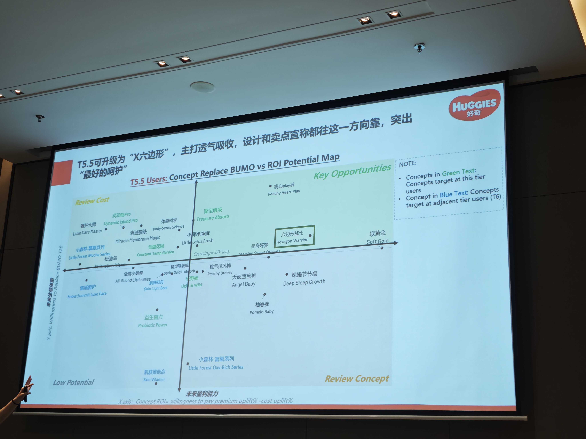

## 本地识读内容

**画面性质**：会议现场拍摄的一张投影幕布照片（非产品照）。画面整体倾斜透视，上方可见天花板吊顶与多盏射灯及其反光，左下角有一根手指入镜。

**图中文字（转写）**

- 右上角 logo：`HUGGIES 好奇`
- 顶部标题（橙红底白字）：
  `T5.5可升级为"X六边形"，主打透气吸收，设计和卖点宣称都往这一方向靠，突出`
  `"最好的呵护"`
- 副标题（绿色）：`T5.5 Users: Concept Replace BUMO vs ROI Potential Map`
- 区域标签：`Review Cost`（左中，橙色）；`Key Opportunities`（右上，绿色）；`Low Potential`（左下）；`Review Concept`（右下）
- 坐标轴：横轴 `x axis: Concept ROI-a willingness to pay premium uplift% - cost uplift%`；纵轴（左侧竖排）`未来盈利能力 Future Profitability (Willingness to pay / BUMO… )`（后半段 [无法辨认]）
- 右上 NOTE 框：
  ```
  NOTE:
   • Concepts in Green Text: Concepts target at this tier users
   • Concept in Blue Text: Concepts target at adjacent tier users (T5)
  ```
- 散点标签（绿色字，本层用户）：
  `看护大师 Love Care Master`；`灵动沁悦 Dynamic Island Pad`；`奇迹魔术 Miracle Membrane Magic`；`体感科学 Body-Sense Science`；`黑宝吸 Treasure Absorb`；`桃Opium裤 / Peach Hoert Play`（英文 [无法辨认]）；`小森林·露曦系列 Little Forest Micro Series`；`恒定花园 Constant-Temper Garden`；`小净适新鲜 LittleFresh`；`星舟好梦 / Rainbow Deep-Night Dream`（英文 [部分无法辨认]）；`六边形战士 Hexagon Warrior`（被方框圈出、高亮）；`软黄金 Soft Gold`
- 散点标签（蓝色字，相邻层 T5 用户）：
  `宝城守护 Snow Summit Love Care`；`全圆小睡裤 全舒睡裤 All-Round Little Bliss`；`元气风裤 Peachy Breezy`；`天使宝宝裤 Angel Baby`；`深睡节节高 Deep Sleep Growth`；`萌力觉醒 Potentio Baby`；`益生力 Probiotic Power`；`小森林·富氧系列 Little Forest Dry-Rich Series`；`肌肤维他命 Skin Vitamin`

**图形结构**

- 一张二维散点定位图（Concept ROI Potential Map）：横轴（x）与纵轴（y）把画面分成四象限；四角分别为 `Low Potential`（左下）、`Review Concept`（右下）、`Review Cost`（左中/左上）、`Key Opportunities`（右上）。
- 各"概念"以圆点 + 中英双语文字标签散布于图中；按 NOTE 说明，绿字为目标层级用户的概念，蓝字为相邻层级（T5）用户的概念。
- `六边形战士 Hexagon Warrior` 一点被矩形方框单独圈出，位于图中偏右中部，[推断] 为主推/对标概念位。
- 文字较多，属于概念组合/卖点定位类幻灯片。

（说明：图中文字为本文转写；带 [推断] 者为识读者推断；[无法辨认] 者为图像模糊无法确认处。）
