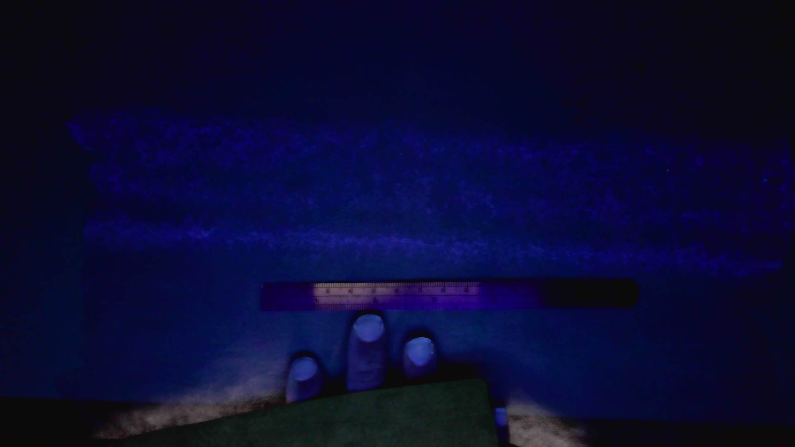

## 本地识读内容

**图中文字**
- 画面中无可直接辨认的文字。中下部深色参照物透光段见细密刻度与疑似字符的纹理，具体字符 [无法辨认]。

**图形结构描述**
- 背景为深蓝近黑的暗场，呈 UV/蓝光荧光显色。
- 画面上部横置一条发光样品带，其质地呈**弥漫、斑驳的雾状**而非清晰线条；样品带下缘有一条**较亮的水平亮线**（边界线）横贯。
- 样品带下方中央横放一条深色条状参照物，中段透出紫粉色光并显露细密刻度状纹理。
- 画面下部可见一只手（拇指与相邻两指）持握参照物/样品，右下为浅色桌面或台面的反光。

**推断**
- [推断] 弥漫斑驳的发光形貌可能对应喷胶/纤维网细密散布（雾化涂布）在 UV 下的显现，与 Code 10/11 的清晰线状图案形成对比。
- [推断] 下缘亮线为材料边界或折边；深色横条为带刻度的尺/笔，用作比例参照。
