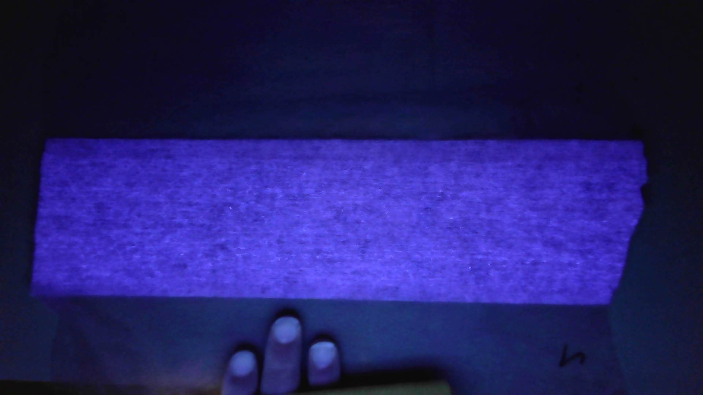

## 本地识读内容

**图中文字**
- 画面右侧偏下位置有一处黑色**手写笔迹状标记**，形态近似字母/数字 "b" 或 "5"，笔画潦草，具体字符 [无法辨认]。
- 无其它可辨认文字。

**图形结构描述**
- 背景为深蓝近黑的暗场，呈 UV/蓝光荧光显色。
- 画面中部为一块**近似矩形的样品块**，UV 下整体呈较**均匀的亮蓝紫色**，表面为细密颗粒/絮状（斑驳点状）纹理，未见明显条纹。
- 样品块右侧边缘不齐并有一处缺口；下缘与下方暗区界线较平直。
- 画面下部正中可见**三根手指**（拇指/食指/中指）托持样品，右下角有黑色手写笔迹状符号。

**推断**
- [推断] 本图与 "Code 2 (2)" 应为同一样品（Code 2）的不同视角/张次，形貌一致（均匀发光、无定向线纹）。
- [推断] 墨迹为该样品的手写编号/标记。
