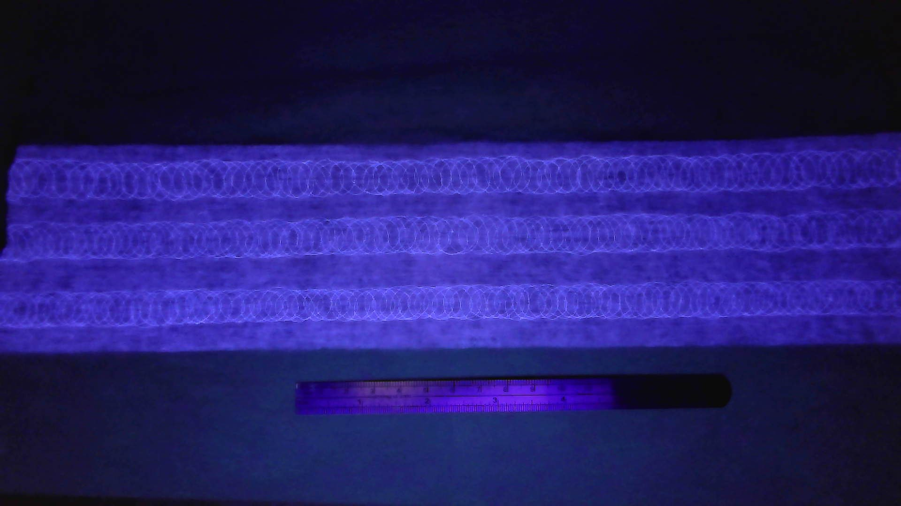

## 本地识读内容

**图中文字**：画面本身无可见文字；试样下方标尺上的刻度数字 **[无法辨认]**（过小且模糊）。

**图形结构描述**

- 深黑背景。上方为一条水平放置的长方形材料试样，发出蓝紫色荧光。
- 试样表面可见 **3 条横向排列的重复环形图案带**（上下两行 + 中间一行），由相互交叠的椭圆/圆环状亮纹密集排列而成，环与环彼此套叠、横向连续（[推断] 为弹性材料/复合结构的打孔、卷曲或针脚（loop）结构在紫外光（黑光）下的荧光成像）。
- 试样下缘较为平直，上缘略有起伏；表面其余部分为细密纤维网纹基材。
- 试样下方单独放置一把**短标尺**作比例参照，标尺发出蓝紫色光，可见密集的细刻度线，但刻度数字 [无法辨认]。
- 画面中无其它文字标注或结构示意。

（说明：带 [推断] 者为识读者推断；[无法辨认] 者为图像模糊无法确认处。）
