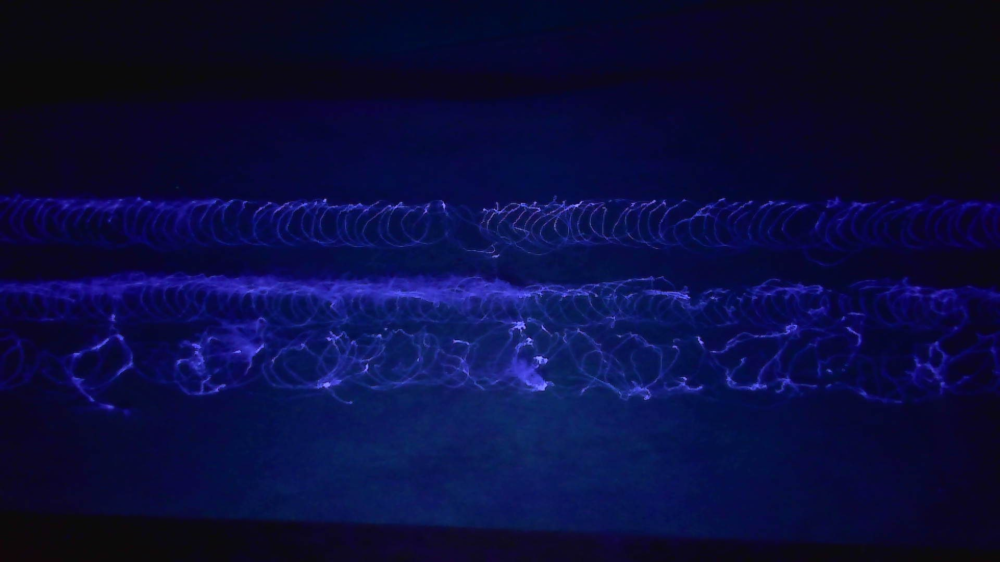

## 本地识读内容

**图中文字**：无。画面中不含任何文字、编号、刻度或标注。

**图形结构描述**

- 深黑/深蓝背景，画面中部有一条水平方向的发光结构，可分为上下两部分：
  - **上部**：一列规则的重复弯钩/半圆形（呈 "C" 或 "U" 状）亮纹，横向排成单独一行，形状整齐、方向一致；中段有一处轻微错位/接口。
  - **下部**：一片较为杂乱、相互缠绕的发光细丝与环状网络，环的大小不一、分布不规则，呈缠结状。
- 整体发出蓝紫色荧光，[推断] 为纤维与弹性体（或胶粘复合区）在紫外光（黑光）照射下的荧光成像：上部似规则的弹性/卷曲结构，下部似纤维缠结或粘合区域。
- 画面中无标尺、无比例参照物、无其它文字或结构示意。

（说明：无文字可转录；带 [推断] 者为识读者推断。）
