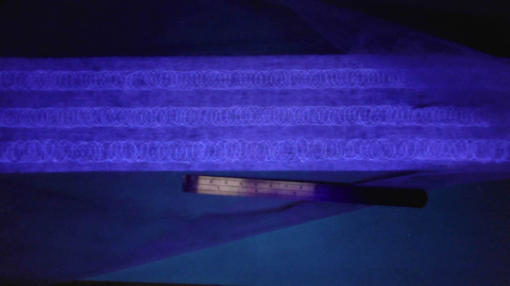

## 本地识读内容

**图中文字**：画面本身无可见文字；试样下方标尺上的刻度数字 **[无法辨认]**（过小且被遮挡）。

**图形结构描述**

- 深蓝背景，上方水平放置一条材料试样，发出蓝紫色荧光。
- 试样表面可见 **3 条横向排列的重复椭圆环状（"O" 形）亮纹带**：环纹较大、清晰、排列整齐，横向连续；行与行之间有水平亮线分隔；试样整体近似被分成 3 条环纹区（[推断] 为弹性复合/针脚（loop）结构在紫外光（黑光）下的荧光成像）。
- 试样右缘呈锯齿状/毛边，左缘略不平整。
- 试样下方放置一把**标尺**作比例参照，标尺可见刻度线，其上斜压一支深色笔状物；标尺刻度数字 [无法辨认]。
- 画面中无其它文字标注或结构示意。

（说明：带 [推断] 者为识读者推断；[无法辨认] 者为图像模糊无法确认处。）
